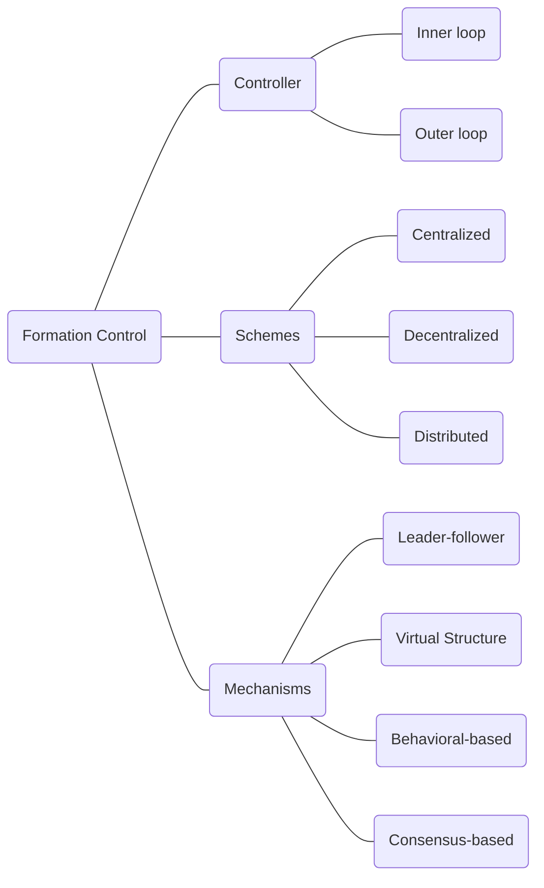

# Resources

- Formation control structure
    
    [Formation Control (Multi-agent) Structures: Leader-Follower, Virtual, and Behavioral-based!! (2/3) - YouTube](https://www.youtube.com/watch?v=ejpkC0Pxg5I)
    
- Formation Control Algorithms for Multiple-UAVs:  A Comprehensive Survey
    
    Formation_Control_Algorithms_for_Multiple-UAVs-A_Comprehensive_Survey.pdf（PDF 講義未公開）
    
    Formation_control_of_unmanned_aerial_vehicle_swarms _A_comprehensive _review.pdf（PDF 講義未公開）
    

# Overview

# Formation Control

## Controller

![[assets/Untitled 9.png]]

- **Inner-loop controller**
    
    → for stabilizing the **single UAV** state
    
- **Outer-loop controller**
    
    → for forming the **multi-UAV** shape
    

## Schemes

- **Centralized**
    
    ![[assets/Untitled 10.png]]
    
    - <u>***Pros:***</u>
        1. Uses global information of **the whole UAV swarm** → Well-handle tasks with **complex control** requirements and provides **high control performance**
    - <u>***Cons:***</u>
        1. Poor resistance to destruction and poor robustness
        2. Bring a large amount of computational burden to the control center
    - <u>***Tasks:***</u>
        1. low real-time requirements
        2. high control performance requirements.
- **Decentralized**
    
    ![[assets/Untitled 11.png]]
    
    - <u>***Pros:***</u>
        1. Strong **fault tolerance**, strong **robustness**, and high **flexibility**.
    - <u>***Cons:***</u>
        1. Weak global optimization performance.
    - <u>***Tasks:***</u>
        1. High dynamics
        2. High real-time
- **Distributed**
    - <u>***Pros:***</u>
    - <u>***Cons:***</u>

## Mechanisms

- **Leader-follower**
    - <u>***Definition:***</u>
        
        Control the **distance** between leader and follower
        
    - <u>***Pros:***</u>
        1. Simple design
        2. Good tracking performance
    - <u>***Cons:***</u>
        1. No feedback from the followers to the leader
- **Virtual Structure(Virtual Leader-based)**
    - <u>***Definition:***</u>
        
        Control to make the **distance** between the **UAV position** and the **ideal UAV position** **converge to 0**
        
    - <u>***Pros:***</u>
        1. High stability
    - <u>***Cons:***</u>
        1. Not flexible 
        2. bad at obstacle avoidance
- **Behavioral-based**
    - <u>***Definition:***</u>
        
        Control from **aggregating multiple small behavior-based controllers**
        
    - <u>***Pros:***</u>
        1. Dealing with multiple-goal mission
    - <u>***Cons:***</u>
        1. Difficult to model
        2. Hard to be in a certain formation
- **Consensus-based**
    - <u>***Definition:***</u>
        
        Includes
        
        - **Leader-follower**
        - **Virtual Structure(Virtual Leader-based)**
        - **Behavioral-based**
    - <u>***Pros:***</u>
    - <u>***Cons:***</u>
        1. Requirement of short communication delay