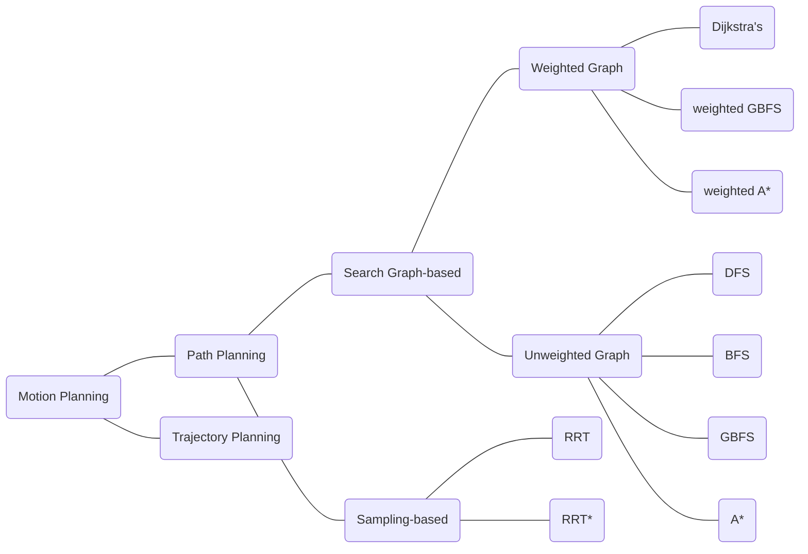

# Resources

- PDSA undirected graph
    
    41UndirectedGraphs.pdf（PDF 講義未公開）
    
- [https://zhuanlan.zhihu.com/p/70802487](https://zhuanlan.zhihu.com/p/70802487)
- Stanford Graph search algorithm
    
    https://cs.stanford.edu/people/abisee/gs.pdf（PDF 講義未公開）
    
- matlab techtalk
    
    [https://www.youtube.com/watch?v=QR3U1dgc5RE&list=PLn8PRpmsu08rLRGrnF-S6TyGrmcA2X7kg&index=4](https://www.youtube.com/watch?v=QR3U1dgc5RE&list=PLn8PRpmsu08rLRGrnF-S6TyGrmcA2X7kg&index=4)
    
- RRT & RRT*
    
    [https://zhuanlan.zhihu.com/p/133224593](https://zhuanlan.zhihu.com/p/133224593)
    

# Overview

# Path Planning

## **Depth-First Search**(DFS)

- <u>***Purpose:***</u>
    1. 找到所有跟原點(s)相連的點
    2. 找到一條**路徑**從原點(s)到其他相連的點
- Property:
    1. Stack : Last in First out(從**後**搜尋的開始往下搜尋)
        
        ![[assets/Untitled 5.png]]
        
- **unweighted graph**

## **Breadth-First Search(**BFS)

- <u>***Purpose:***</u>
    1. 找到所有跟原點(s)相連的點
    2. 找到一條**最短路徑**從原點(s)到其他相連的點
- <u>***Property***</u>:
    1. Queue : First in First out (從**先**搜尋的開始往下搜尋)
        
        ![[assets/Untitled 6.png]]
        
    2. 速度慢
    3. 最短路徑
- **unweighted graph**

## Greedy Best First Search(GBFS)

- <u>***Purpose:***</u>
    1. **比較快**地找到一條路徑使原點(s)跟目標點(t)相連
- <u>***Property:***</u>
    1. 加入 **heuristic** :  使用與目標點(t)較近的frontier的點先做訪問
    2. 速度快
    3. 不一定是最短路徑
- **unweighted graph**

## A*

- <u>***Purpose:***</u>
    1. **比較快**且以**最短**的方式找到一條路徑使原點(s)及目標點(t)相連
- <u>***Property:***</u>
    1. 加入 **heuristic** + **steps** from s: 使用與目標點(t) 距離+ frontier 的點距離最短之和的點
    2. 速度快
    3. 最短路徑

<aside>
💡 A* = BFS+GBFS

</aside>

- **unweighted graph**

## Dijkstra’s Algorithm

- <u>***Purpose:***</u>
    1. 找到所有跟原點(s)相連的點
    2. 在考慮每一線段有不同cost(weight)的情況下，找到一條**cost總和最小路徑**從原點(s)到其他相連的點
- <u>***Property:***</u>
    1. 速度慢
    2. cost最小路徑

<aside>
💡 當每一條線段的weight = 1時，Dijkstra’s = BFS

</aside>

- **weighted graph**

## Weighted Greedy Best First Search(GBFS)

- <u>***Purpose:***</u>
    1. **比較快**地找到一條路徑使原點(s)跟目標點(t)相連
- <u>***Property:***</u>
    1. 加入 **heuristic** :  使用與目標點(t)cost 最小的frontier的點先做訪問
    2. 速度快
    3. 不一定是cost 最小路徑
- **weighted graph**

## Weighted A*

- <u>***Purpose:***</u>
    1. **比較快**且以**cost最小**的方式找到一條路徑使原點(s)跟目標點(t)相連
- <u>***Property:***</u>
    1. 加入 **heuristic** + cost from s: 使用與目標點(t) cost+ frontier 的點cost最小之和的點
    2. 速度快
    3. cost最小路徑

<aside>
💡 A* = Dijkstra’s +GBFS

</aside>

- **weighted graph**

## **Rapidly-exploring Random Trees(**RRT)

- <u>***Purpose:***</u>
    1. **比較快**地找到一條路徑使原點(s)跟目標點(t)相連
- <u>***Property:***</u>
- <u>***Algorithm:***</u>
    1. 設定max step size
    2. 隨機選取下一步的位置，且選到的位置距離最近的node要小於 max step size
    3. 再檢查選到的位置距離最近的node之間有沒有障礙物，若沒有障礙物則完成一次搜索
    4. 重複 2-3 步驟，直到選到目標點(t)
    - Pseudo code
        
        ![[assets/Untitled 7.png]]
        

## RRT*

- <u>***Purpose:***</u>
    1. **比較快**且以**最短**的方式找到一條路徑使原點(s)及目標點(t)相連
- <u>***Property:***</u>
    1. **比較快**跟**最短**可以視為trade-off，迭代越久路徑越短速度越慢
    2. 與RRT 相比，多了一個rewrite parent node的過程
- <u>***Algorithm:***</u>
    1. 設定max step size
    2. 隨機選取下一步的位置，且選到的位置距離最近的node要小於 max step size
    3. **再比較距離選到的位置r範圍內的所有node並選擇總距離最短的node相連，若原本的node已經有parent node，則更改他的parent node成選到的位置**
    4. 再檢查選到的位置與parent node, child node之間有沒有障礙物，若沒有障礙物則完成一次搜索
    5. 重複 2-4 步驟，直到選到目標點(t)
    6. 選到目標點(t)之後，持續重複 2-4 步驟則會持續最小化路徑
    - Pseudo code
        
        ![[assets/Untitled 8.png]]
        

# Compare

## Search Graph-based

| <u>*Algorithms*</u> | <u>***speed***</u> | <u>***path length***</u> | <u>***cost***</u> | <u>***notes***</u> |
| --- | --- | --- | --- | --- |
| DFS | slow | not shortest | x |  |
| BFS | slow | shortest | x |  |
| GBFS | fast | not shortest | x |  |
| A* | fast | shortest | x | BFS+GBFS |
| Dijkstra’s  | slow | x | the least |  |
| weighted GBFS | fast | x | not the least |  |
| weighted A* | fast | x | the least | Dijkstra’s+ weighted GBFS |

## Sampling-based

| <u>*Algorithms*</u> | <u>***speed***</u> | <u>***path length***</u> | <u>***cost***</u> | <u>***notes***</u> |
| --- | --- | --- | --- | --- |
| RRT | fast | not shortest | x |  |
| RRT* | fast | shortest | x | fast & short are trade-off |